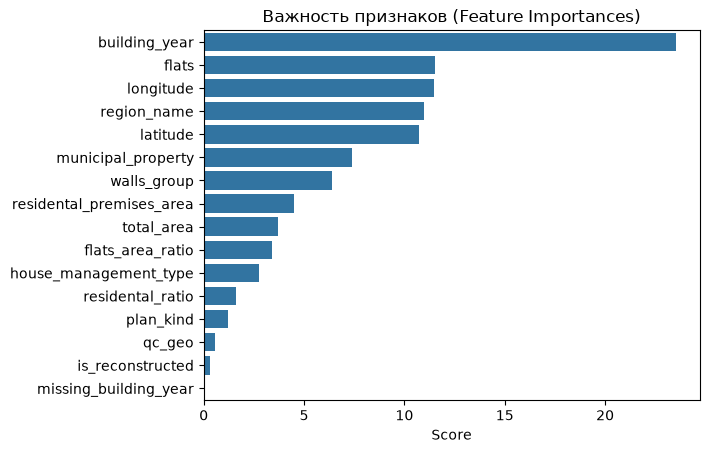
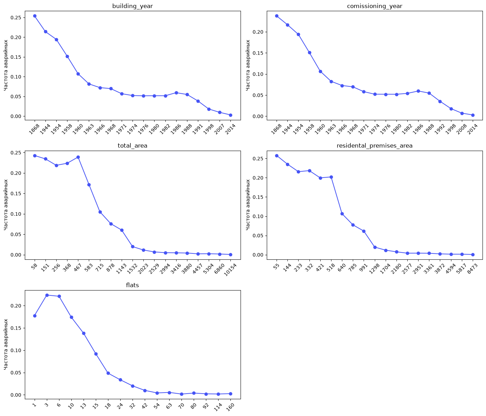
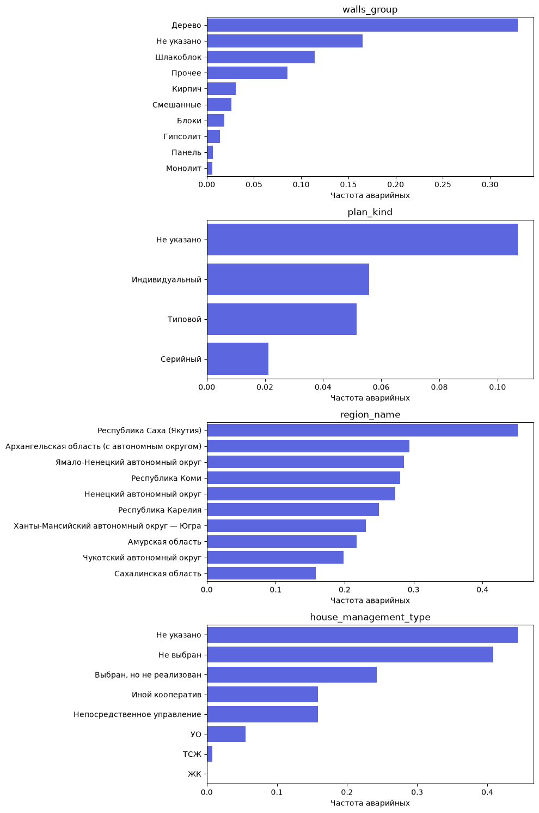

# Предсказание аварийности многоквартирных домов в России

Можно ли по данным реестра ГИС ЖКХ предсказать, что дом признан аварийным или ветхим? И что сильнее влияет на этот статус: физические характеристики здания (возраст, размер, материал стен) или институциональные и пространственные факторы (регион, способ управления, собственность)?

Модель CatBoost на ~830 тыс. домов проверялась на муниципалитетах, которых не видела при обучении.

**Главное:**
- **ROC-AUC 0,94, PR-AUC 0,60** при доле проблемных домов 8,2%.
- **84% точности в верхнем 1% прогнозов.** Среди 1% домов с наибольшим предсказанным риском 84% действительно имеют статус аварийного или ветхого. Это в 10 раз выше, чем при случайном выборе.
- **Возраст и размер здания — главные факторы** (≈56% важности). Местоположение даёт ≈33% даже при одинаковых характеристиках домов.

## Данные

[Датасет «Износ и аварийность жилых домов»](https://tochno.st/datasets/gisgkh) от «Если быть точным»: выгрузка из ГИС ЖКХ по состоянию на ноябрь 2025 года, ~956 тыс. домов, 33 признака.

| Состояние | Домов | Доля |
|---|---|---|
| Исправный | 857 093 | 90,7% |
| Аварийный | 79 031 | 8,4% |
| Ветхий | 9 238 | 1,0% |

Целевая переменная бинарная: «Аварийный» и «Ветхий» — класс 1, «Исправный» — класс 0. Дома без указанного состояния исключены.

## Подход

### Очистка данных
Код очистки находится в [src/preprocessing.py](src/preprocessing.py):
- **Материал стен.** Больше 2 тыс. вариантов написания (`«кирпичные, ж/б плиты»`, `«брус»`, `«шлакоблок»`…) регулярными выражениями сведены к 10 группам: дерево, кирпич, панель, блоки, шлакоблок и т.д.
- **Серия проекта.** Около 57 тыс. вариантов сведены к типу проекта: серийный, типовой, индивидуальный.
- **Код муниципалитета (ОКТМО).** Пропуски восстановлены по почтовому индексу: берётся самый частый ОКТМО среди домов с тем же индексом.
- **Год постройки.** Диапазоны вида «2001, 2002» приводятся к первому году, пропуски заполняются годом ввода в эксплуатацию, невалидные значения (до 1800 года и после 2026-го) обнуляются.
- **Площадь.** Дома с площадью 0–1 м² удалены. Добавлены отношения «квартир на м²» и «доля жилой площади».

### Исключённые признаки
- **Утечка целевой переменной.** Исключены процент износа (статус «ветхий» определяется через износ), стадия жизненного цикла («Расселён», «Снос») и управляющая организация (у расселённых домов её нет).
- **Код муниципалитета.** Используется только для группировки при валидации, в модель не входит.

### Модель и валидация
- **CatBoost** с нативной обработкой категориальных признаков.
- **StratifiedGroupKFold** (5 фолдов, группировка по муниципалитету). Все дома одного муниципалитета целиком попадают либо в обучение, либо в валидацию. Так модель проверяется на новых территориях, а не на соседях уже знакомых ей домов.

## Результаты

| Метрика | Значение |
|---|---|
| ROC-AUC (среднее по фолдам) | 0,940 (от 0,927 до 0,951) |
| PR-AUC | 0,60 (случайный уровень ≈ 0,08) |
| Precision / Recall при пороге 0,26 | 0,52 / 0,66 |

Для приоритизации проверок полезнее смотреть на точность среди домов с наибольшим риском:

| Верхние, % домов | Домов | Precision | Recall | Лифт |
|---|---|---|---|---|
| 1% | 8 315 | 84% | 10% | ×10,3 |
| 2% | 16 631 | 79% | 19% | ×9,7 |
| 5% | 41 579 | 67% | 41% | ×8,2 |
| 10% | 83 159 | 52% | 64% | ×6,4 |
| 20% | 166 319 | 36% | 88% | ×4,4 |

### Что влияет на статус



| Группа | Признаки | Важность |
|---|---|---|
| Инфраструктурные | год постройки, число квартир, площади, материал стен, серия, реконструкция | ≈ 56% |
| Пространственные | регион, координаты | ≈ 33% |
| Институциональные | муниципальная собственность, способ управления | ≈ 10% |

Доля проблемных домов резко падает для домов, построенных после 1960 года, и для домов больше 15–20 квартир:



Деревянные дома, северные регионы и дома без выбранного способа управления — группы с наибольшей долей аварийного фонда:



## Ограничения
- **Модель предсказывает официальный статус, а не реальное техническое состояние.** Признание дома аварийным — административная процедура, поэтому часть «ложных срабатываний» может оказаться непризнанными проблемными домами. Проверить это можно только обследованием.
- **Вклад местоположения не обязательно административный.** Регион и координаты отражают также климат, локальные типы застройки и период массового строительства.
- **Институциональные признаки могут быть следствием статуса.** При расселении квартиры переходят в муниципальную собственность, а управляющие компании отказываются от аварийных домов.
- **Важность признаков посчитана по модели одного фолда** и не означает причинно-следственной связи.

## Структура проекта

```
├── data_research.ipynb      # EDA, обучение, метрики, выводы
├── src/preprocessing.py     # очистка данных и генерация признаков
├── images/                  # графики для README
└── requirements.txt
```

## Как запустить

Нужен Python 3.12.

```bash
git clone https://github.com/ascat41/HouseDeterioration.git
cd HouseDeterioration
python -m venv .venv && source .venv/bin/activate
pip install -r requirements.txt
```

Скачайте CSV-файл датасета со [страницы «Если быть точным»](https://tochno.st/datasets/gisgkh) и положите его в корень репозитория под именем `data_gisgkh_157_v20260917.csv`. Затем откройте `data_research.ipynb` и выполните все ячейки. Кросс-валидация CatBoost занимает основное время.

Очистку можно использовать отдельно от ноутбука:

```python
from src import preprocessing as prep

df = prep.preprocess(prep.load_data("data_gisgkh_157_v20260917.csv"))
```
